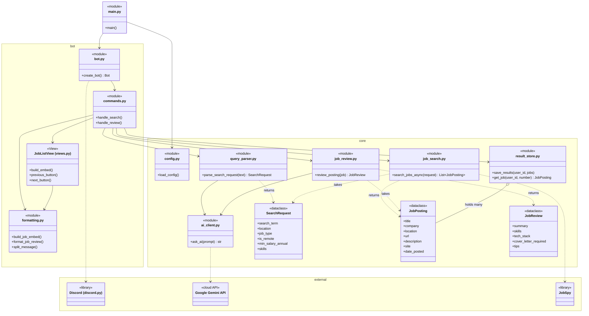

# Class Diagram

Most files are modules of functions, so they are marked `<<module>>`. Arrows between
the `bot` and `core` groups only point from `bot` to `core`.

The data classes show only their main fields. See `core/models.py` for the full list.